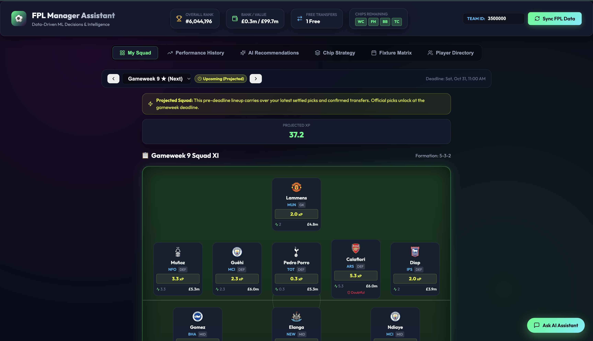
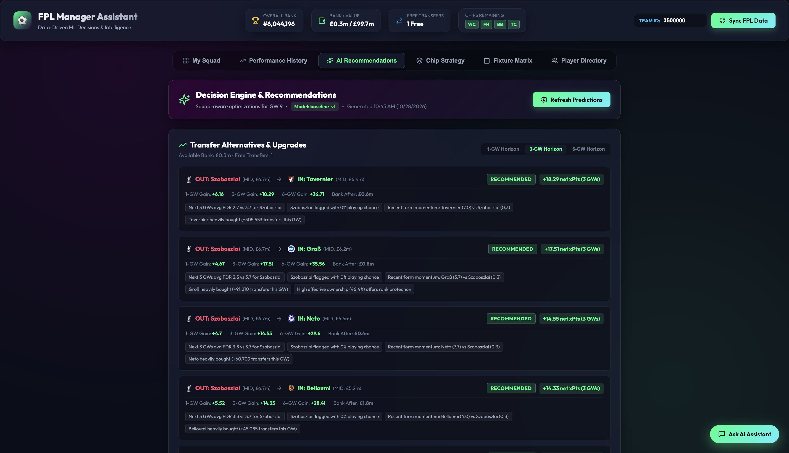
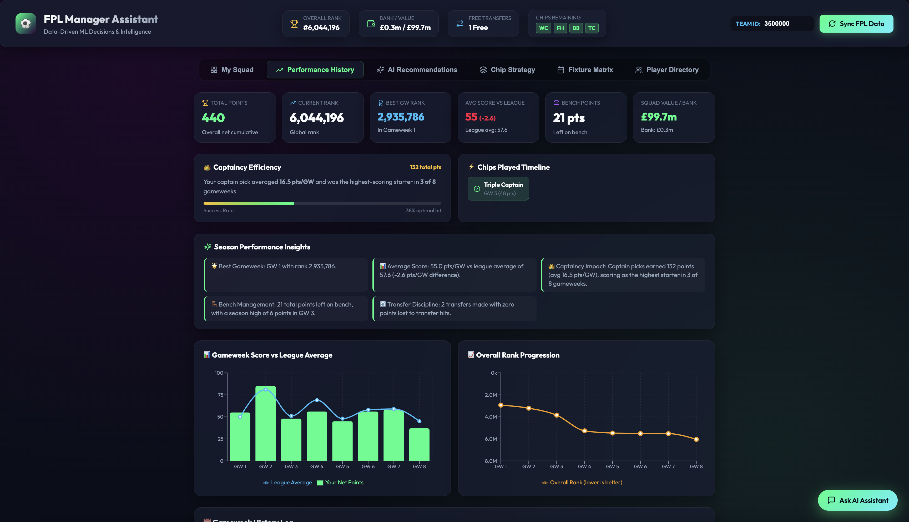
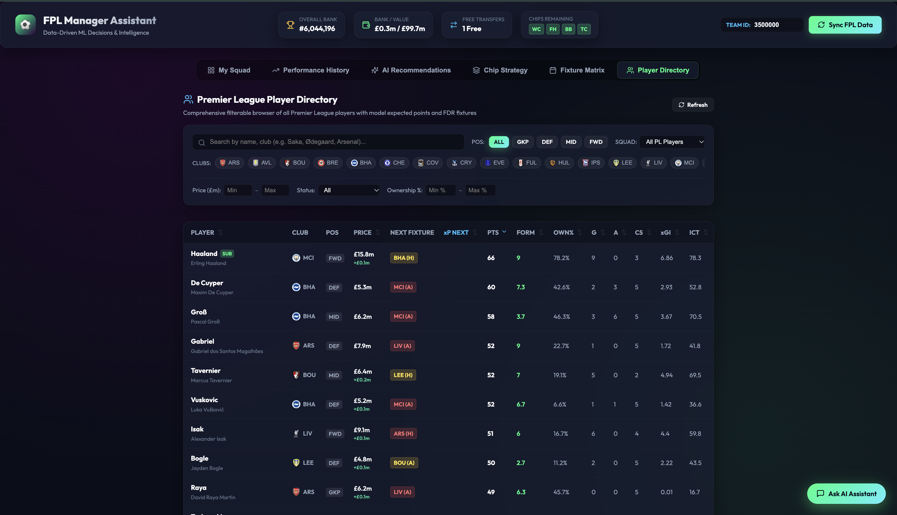
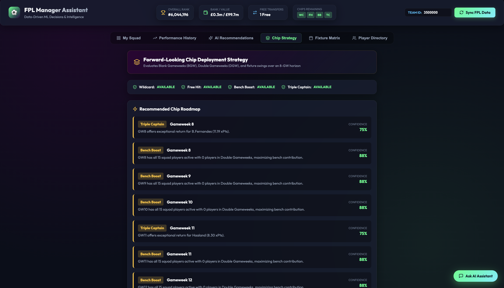

# Personal FPL Assistant ⚽

> A personalized, data-driven Fantasy Premier League decision-support system. Java (Spring Boot) owns the product/API layer, Python owns data/ML, and a local LLM (Ollama) explains model outputs in plain-English advice. Zero-cost, local-first, containerized.

[](https://www.oracle.com/java/)
[](https://spring.io/projects/spring-boot)
[](https://www.python.org/)
[](https://fastapi.tiangolo.com/)
[](https://react.dev/)
[](https://www.typescriptlang.org/)
[](https://www.postgresql.org/)
[](https://www.docker.com/)
[](https://ollama.com/)

---

## 📸 Application Tour & Interface

> *Tip: Click any image to view it full size in your browser.*

### 1. Tactical Pitch View & Expected Points (`My Squad`)
Visualizes your active starting XI and bench in real tactical formations (e.g., 3-5-2, 5-3-2) with projected squad expected points ($xP$), official FPL player card attributes, vice/captain indicators, real-time injury flags, and projected pre-deadline lineups.

[](docs/screenshots/squad-pitch-view.png?raw=true)

---

### 2. Decision Engine & Transfer Recommendations (`AI Recommendations`)
Squad-aware optimization recommending transfer-in / transfer-out pairs across **1-GW, 3-GW, and 6-GW horizons**. Evaluates net expected points gained ($\Delta xP$), budget impact, fixture difficulty swings, recent form momentum, ownership trends, and tactical rationale.

[](docs/screenshots/ai-recommendations.png?raw=true)

---

### 3. Season Performance History & Gameweek Analytics (`Performance History`)
Comprehensive retrospective intelligence comparing cumulative score against overall league average, global rank trajectory, captaincy efficiency (average points per gameweek & optimal hit rate), points left on the bench, and transfer discipline with zero points lost to hits.

[](docs/screenshots/performance-history.png?raw=true)

---

### 4. Premier League Player Directory (`Player Directory`)
Filterable, searchable browser of all Premier League players. Filter by position (GKP, DEF, MID, FWD), squad affiliation, club, price range, injury status, and ownership percentage. Compare model projected $xP$, recent form, ICT index, and color-coded upcoming fixture difficulty ratings (FDR).

[](docs/screenshots/player-directory.png?raw=true)

---

### 5. Forward-Looking Chip Deployment Strategy (`Chip Strategy`)
8-gameweek forecasting engine evaluating Blank Gameweeks (BGW), Double Gameweeks (DGW), and fixture swings. Provides tactical confidence scores and targeted gameweeks to deploy Wildcard, Free Hit, Bench Boost, and Triple Captain.

[](docs/screenshots/chip-strategy.png?raw=true)

---

## 📐 System Architecture

```
┌─────────────────────────────────────────────────────────────────┐
│  React + TS + Vite (Frontend)                                  │
│  Squad Pitch · Fixture FDR Matrix · AI Recs · Chip Strategy · Chat │
└───────────────────────────┬─────────────────────────────────────┘
                             │ REST/JSON
┌───────────────────────────▼─────────────────────────────────────┐
│  Java / Spring Boot 3.3 (Core API & Orchestration)             │
│  - Squad & User State Management   - FPL Official API Sync       │
│  - Business & Budget Rules        - Recommendation Proxy        │
│  - PostgreSQL Access (JPA)        - Grounded LLM Chat Service   │
│  - Intent Classifier & Resolver   - Response Validator (Guard)  │
│  - Deterministic Fallback Engine  - Conversation Memory Store   │
└──────────┬───────────────────────────────────────┬──────────────┘
           │ REST                                  │ REST
┌──────────▼───────────────────────┐   ┌────────────▼──────────────┐
│  Python / FastAPI (ML Service)   │   │  Ollama (Local LLM)        │
│  - Feature Engineering Pipeline  │   │  - Grounded Explanations   │
│  - Start Probability Classifier  │   │  - Natural Language Q&A    │
│  - xPoints Model & Backtesting   │   └───────────────────────────┘
│  - Transfer/Captain/Chip Scorer  │
└──────────┬───────────────────────┘
           │
┌──────────▼──────────────────────────────────────────────────────┐
│  PostgreSQL 16 Database — players, teams, fixtures, gameweeks,  │
│  my_team, player_stats, predictions, recommendations, chat     │
└─────────────────────────────────────────────────────────────────┘
```

---

## ✨ Core Features

- **🏆 Tactical Pitch View**: Interactive pitch visualization for starting XI and substitute bench with captain (C) / vice-captain (V) badges, price (£m), form, and injury status.
- **📈 Squad-Aware Transfer Scorer**: Ranks transfer pairs by net expected points gain over a 3-GW horizon ($\text{xPts}_{\text{in}} - \text{xPts}_{\text{out}} - \text{hit\_cost}$), enforcing FPL budget and 3-players-per-club constraints.
- **👑 Risk-Adjusted Captaincy Ranker**: Ranks squad starters for Safe (high floor) vs. Differential (high ceiling) captain choices.
- **🛡️ Squad Weakness & Differential Detector**: Highlights low-xPoints/injured starters needing transfer attention and low-ownership (<10%) target gems.
- **📊 Performance History & Analytics**: Deep analysis of historic gameweek scores vs. league average, rank tracking, bench points, and captain pick success.
- **🔍 Player Directory**: Full filterable database of all 600+ Premier League players with search, price filters, next fixture FDR, form, and xPoints.
- **📅 Fixture Difficulty Rating (FDR) Matrix**: Multi-gameweek fixture runs (3, 5, 8 GW horizon) for all 20 Premier League clubs with color-coded difficulty badges (1-5) and Blank/Double GW flags.
- **🚀 Chip Strategy Roadmap**: Forward-looking 8-GW timeline planning optimal deployment windows for Wildcard, Free Hit, Bench Boost, and Triple Captain.
- **💬 Grounded AI Chat Assistant**: Interactive AI assistant powered by local Ollama with intent classification, multi-turn conversation memory, response validation, and automatic deterministic fallback when Ollama is offline.

---

## 🤖 AI Chat Assistant & Ollama Configuration

The AI Chat Assistant answers queries grounded strictly in live squad data, expected points models, and transfer rankings.

### Model Requirements & RAM
| Model | Parameter Size | Approximate RAM Required | Recommended For |
|---|---|---|---|
| `llama3.1:8b` (Default) | 8 Billion | ~8 GB - 12 GB RAM | Balanced analytical reasoning & phrasing |
| `mistral:7b` | 7 Billion | ~6 GB - 8 GB RAM | Low-memory setups |
| `qwen2.5:7b` | 7 Billion | ~8 GB RAM | Highly concise structured Markdown |

### Switching Models
Configure via `.env` or environment variables:
```bash
# In .env:
OLLAMA_URL=http://localhost:11434
OLLAMA_MODEL=llama3.1:8b
```
Pull the model in your local terminal:
```bash
ollama pull llama3.1:8b
```

### Automatic Zero-Downtime Fallback
If Ollama is stopped, times out, or the model is not pulled, the assistant automatically switches to **`DETERMINISTIC_FALLBACK`** mode. It returns formatted, accurate, real-time answers directly from the database and scoring engines without generic placeholders.

---

## 💬 10 Sample Chat Questions & Expected Behaviors

1. **"what all are my remaining chips?"**
   - *Behavior*: Returns the exact list of remaining chips (e.g. Wildcard, Free Hit, Triple Captain) from `my_team_state`, bank balance, and free transfers in 1-2 concise sentences.
2. **"when should i play wildcard?"**
   - *Behavior*: Returns tactical chip strategy recommendations highlighting upcoming BGW/DGW horizons and fixture swing windows.
3. **"hey, what transfer should i make this week?"**
   - *Behavior*: Returns a structured table of top recommended transfers (out → in), projected net points gain (1-GW and 3-GW), cost/hits, and recommendation verdict.
4. **"who should i captain?"**
   - *Behavior*: Returns the #1 starting XI captain choice with expected points, matchup FDR, risk profile, and a designated vice-captain candidate.
5. **"what are my squad's weaknesses?"**
   - *Behavior*: Returns overall squad health score out of 100 and a prioritized audit list of starting XI/bench liabilities with action suggestions.
6. **"compare haaland and palmer"**
   - *Behavior*: Resolves both players and renders a side-by-side metric comparison table (price, form, total points, minutes, projected xP) with a data-backed verdict.
7. **"why not him instead?"** (follow-up after player compare)
   - *Behavior*: Multi-turn pronoun resolution identifies the previously discussed alternative from conversation history and outputs the player's stat card.
8. **"give me some differential picks"**
   - *Behavior*: Ranks players under 10% ownership with the highest projected xPoints over upcoming gameweeks.
9. **"who has the easiest fixtures?"**
   - *Behavior*: Analyzes fixture ticker FDR schedules over the next 3-4 gameweeks for attacking and defensive assets.
10. **"when is the deadline for gw9?"**
    - *Behavior*: Factual summary of FPL deadline rules (strictly 90 minutes before the gameweek's first kickoff) and transfer point deductions.

---

## 🚀 Quick Start with Docker Compose

Ensure Docker Desktop is running on your system, then run:

```bash
# 1. Clone the repository
git clone https://github.com/Pratham2305/eFPL.git
cd eFPL

# 2. Copy environment file and configure your FPL Team ID
cp .env.example .env
# Edit .env and set FPL_TEAM_ID=your_id

# 3. Start all services
docker compose up -d --build
```

Access the services:
- **Frontend Dashboard**: `http://localhost:3000`
- **Java Spring Boot API**: `http://localhost:8080/api/team/current`
- **Chat Health Check**: `http://localhost:8080/api/chat/health`
- **Python ML Service**: `http://localhost:8000/docs` (Swagger UI)
- **Ollama LLM**: `http://localhost:11434`

---

## 🧪 Local Testing & Verification

### Java Backend Tests (60 Unit & Integration Tests)
```bash
cd backend-java
./mvnw test
```

### Python ML Service
```bash
cd ml-service
python3 -m venv venv
./venv/bin/pip install -r requirements.txt pytest
./venv/bin/pytest
```

---

## 📊 Guiding Principles

1. **Numbers come from data/ML, not the LLM.** The LLM narrates and explains structured model outputs; it never invents an expected-points number.
2. **No recommendation in isolation.** Every suggestion is squad-aware, budget-aware, and fixture-aware.
3. **MVP over impressiveness.** Every technology in the stack has a clear boundary and job.
4. **Zero cost.** Free official FPL API, local PostgreSQL, local LLM (Ollama), containerized via Docker Compose.
